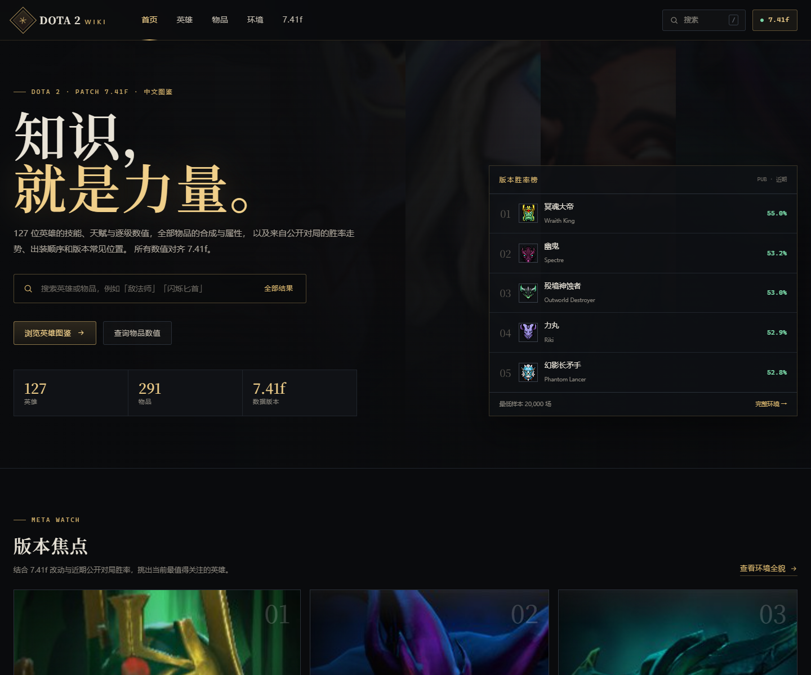

# DOTA 2 WIKI · 7.41f

一个面向 **Dota 2 7.41f** 的纯静态中文图鉴：英雄技能逐级数值、天赋、神杖 / 魔晶升级、物品价格与效果、合成路径，以及基于 OpenDota 公开对局的胜率走势、出装热度和克制关系。

- 127 位英雄 · 291 件物品（含中立物品与附魔）
- 英雄头像 / 立绘 / 技能图标 / 物品图标全部本地化
- 无后端、无构建步骤、无外部字体；可直接部署到 GitHub Pages
- 桌面与移动端适配，支持站内搜索、属性 / 定位 / 位置 / 物品分类筛选



## 本地预览

不要直接双击 HTML（浏览器会拦截 `fetch` 读取 JSON）。使用任意静态服务器：

```bash
# Node.js 20+
npm run serve
# 打开 http://127.0.0.1:4173
```

或者：

```bash
python -m http.server 4173
```

## 部署到 GitHub Pages

### 方式一：GitHub Actions（推荐）

仓库已包含 `.github/workflows/pages.yml`。

1. 推送到 `main` 分支。
2. 打开仓库 **Settings → Pages**。
3. **Build and deployment → Source** 选择 **GitHub Actions**。
4. 工作流会自动把 `index.html`、`css/`、`js/`、`data/`、`assets/` 发布到 Pages。

### 方式二：从分支部署

**Settings → Pages → Deploy from a branch**，选择 `main` 和 `/ (root)`。仓库根目录的 `.nojekyll` 会关闭 Jekyll 处理，保证 `data/` 与 `assets/` 原样发布。

所有页面使用相对路径，因此部署在 `https://<user>.github.io/<repo>/` 这样的子路径下也能正常工作。

## 数据更新

需要 Node.js 20+ 和网络连接：

```bash
npm run data
```

该命令依次执行：

1. `scripts/fetch-raw.mjs` — 从 Valve 官方 datafeed 拉取英雄、技能、物品、天赋和 7.41f 补丁说明；从 OpenDota 拉取胜率、出装与对位；缓存到 `research/raw/`。
2. `scripts/build-data.mjs` — 生成 `data/heroes-index.json`、`data/heroes/*.json`、`data/items-index.json`、`data/items/*.json`、`data/meta.json`、`data/patch.json`。
3. `scripts/fetch-assets.mjs` — 从 Steam CDN 下载英雄头像、立绘、技能图标和物品图标到 `assets/`。

也可以单独运行：

```bash
npm run data:raw
npm run data:build
npm run data:assets
```

版本号、补丁说明接口和更新时间目前写在 `scripts/build-data.mjs` 顶部（`PATCH` / `UPDATED`）以及 `scripts/fetch-raw.mjs` 的补丁接口中。新版本发布后，修改版本号与接口参数即可重新生成。

重新下载素材后，可以在 Windows 上运行以下可选步骤，把 CDN 返回的 16-bit 大图重新编码成适合网页的大小：

```powershell
pwsh -File scripts/optimize-assets.ps1
```

数据完整性检查（不依赖浏览器）：

```bash
node scripts/validate-data.mjs
```

## 数据口径

| 内容 | 来源 | 说明 |
| --- | --- | --- |
| 英雄 / 技能 / 天赋 / 物品数值 | Valve Dota 2 官方 datafeed | 中文名称、描述、逐级数值；对齐 7.41f |
| 补丁说明 | Valve 官方 7.41f 更新页 | 中文条目参考官方中文与社区整理 |
| 胜率 / 登场率 | OpenDota `heroStats` | 公开对局样本约 383 万场 |
| 七日走势 | OpenDota `pub_pick_trend` / `pub_win_trend` | 七个统计窗口，末位可能未完整 |
| 出装 | OpenDota `itemPopularity` | 出门 / 前期 / 中期 / 后期，按阶段最高值归一化热度 |
| 克制 | OpenDota `matchups` | 仅保留 ≥25 场对局，样本较小时波动明显 |
| 常见位置 | 编辑整理 | 1–5 号位，用于图鉴导航，不是赛事位置统计 |
| 图像 | Steam CDN / Valve | 英雄头像、立绘、技能与物品图标 |

登场率按“每场出现率”计算：`英雄选取数 / 总对局数 × 100`，因此所有英雄相加约为 **1000%**。

## 项目结构

```text
.
├── index.html              首页
├── heroes.html             英雄库
├── hero.html               英雄详情（?id=antimage）
├── items.html              物品库
├── item.html               物品详情（?id=blink）
├── meta.html               环境数据
├── patch.html              7.41f 补丁
├── about.html              关于与数据来源
├── 404.html
├── css/style.css
├── js/
│   ├── core.js             共享工具、页头页脚、搜索
│   ├── home.js
│   ├── heroes.js
│   ├── hero.js
│   ├── items.js
│   ├── item.js
│   ├── meta.js
│   └── patch.js
├── data/                   生成后的 JSON（随仓库提交）
├── assets/                 本地图像（随仓库提交）
├── scripts/                抓取、构建、下载、预览脚本
└── .github/workflows/      GitHub Pages 部署
```

## 数据与版权

这是一个**非官方、非商业**的粉丝项目，与 Valve Corporation 没有关联，也未获得其背书。

- Dota 2、英雄、物品、技能名称、图像及相关素材版权归 **Valve Corporation** 所有。
- 本站代码以 **MIT** 许可证发布；Valve 的数据与图像**不在** MIT 授权范围内。
- 使用本站素材时，请同时遵守 [Valve 粉丝内容指引](https://www.valvesoftware.com/en/fan-content)。
- 公开对局统计来自 [OpenDota](https://www.opendota.com/)；OpenDota 是独立开源项目。
- 详见 [NOTICE.md](NOTICE.md) 与 [LICENSE](LICENSE)。

如果你发现数值、翻译或图片问题，欢迎提交 issue 或 PR。
